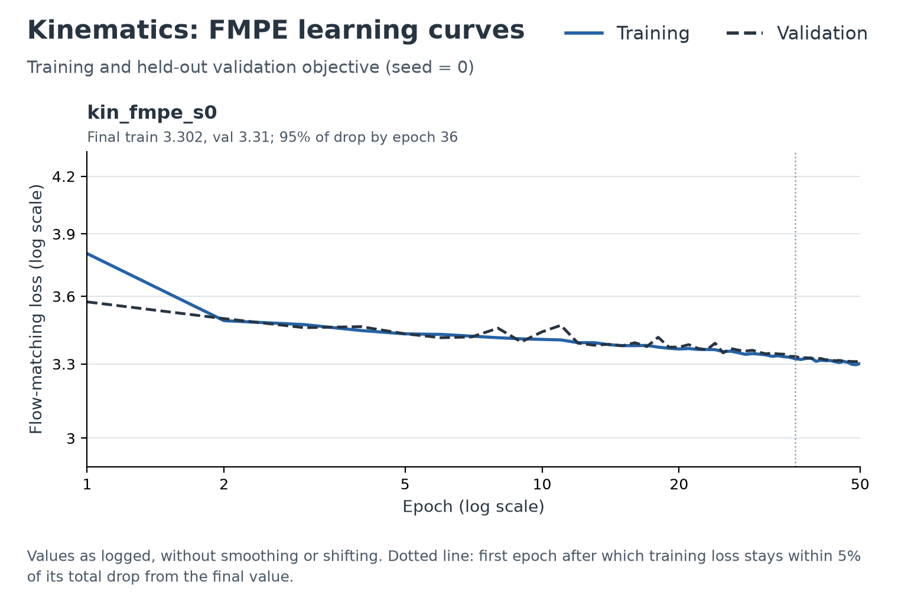
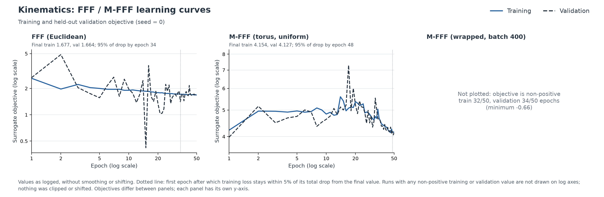
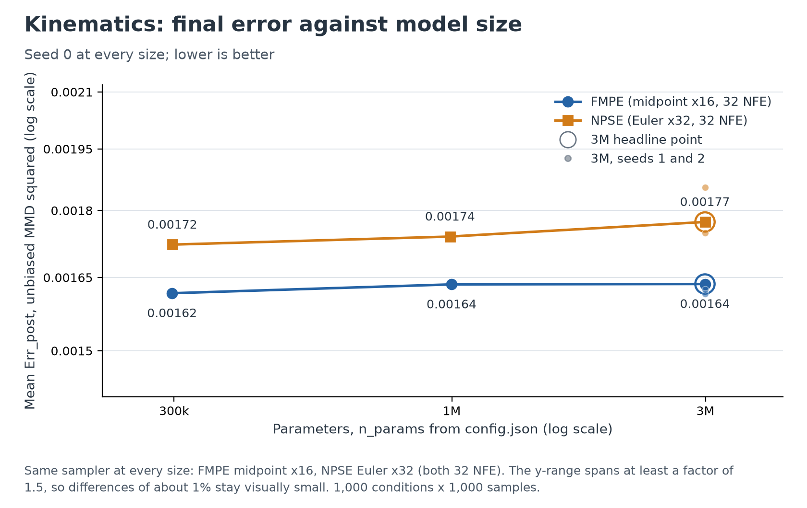
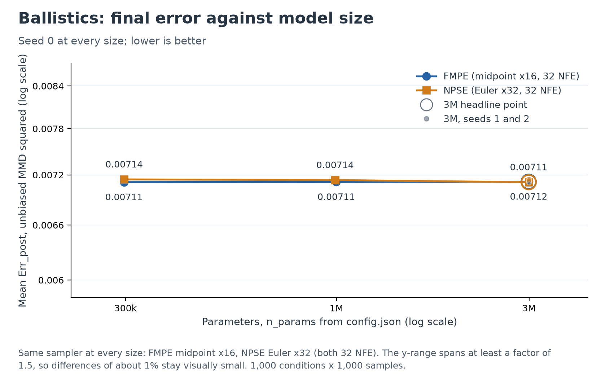
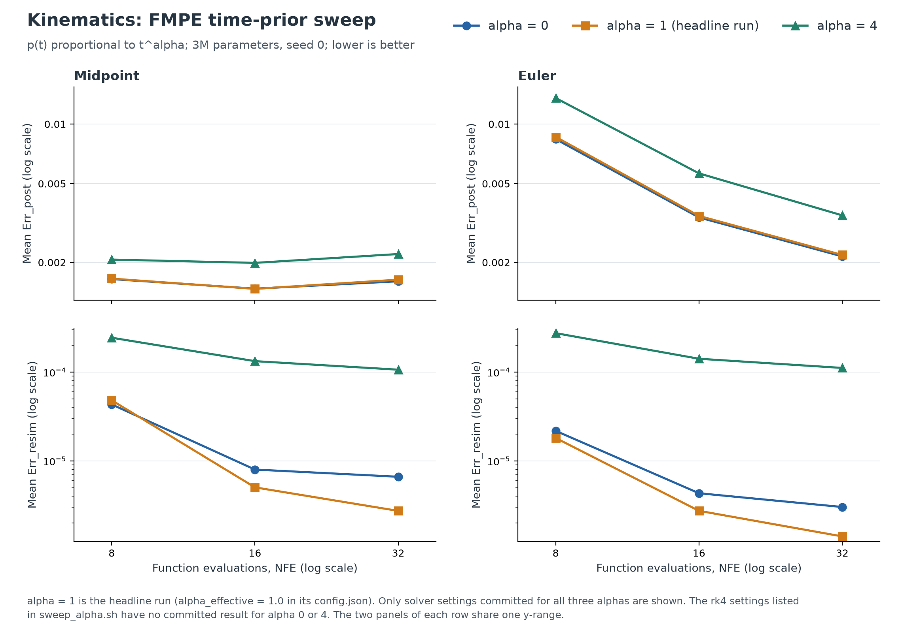
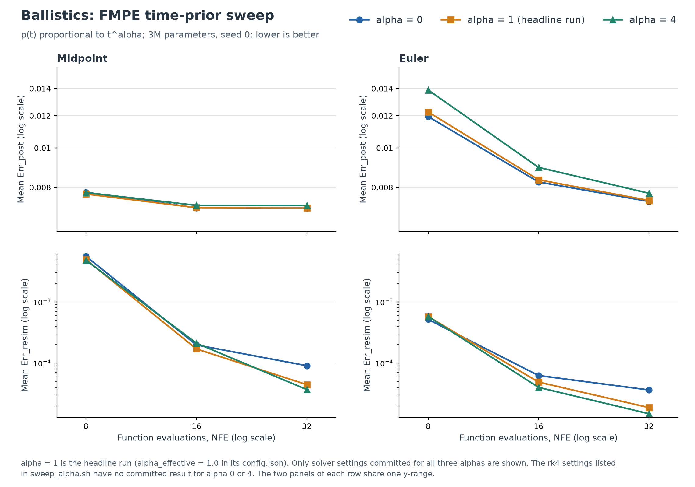
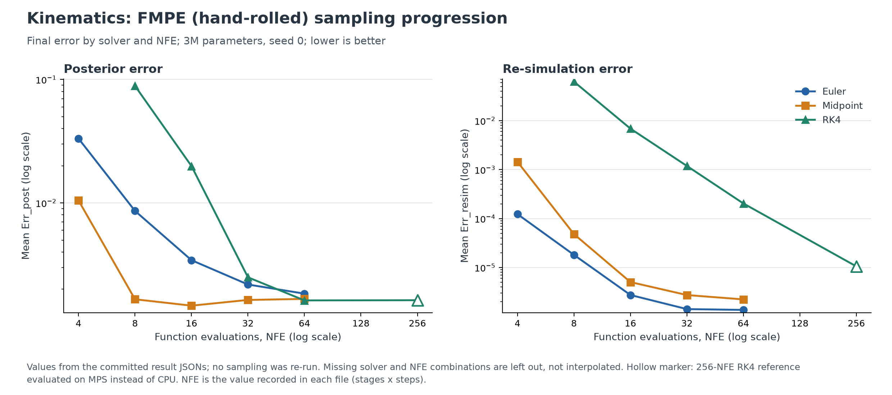
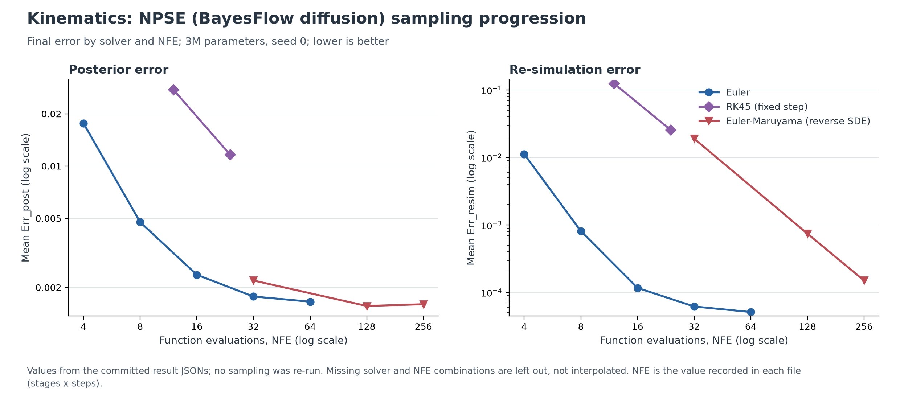

# Analysis plots

Diagnostic figures for the report, with interpretations. Everything is read from committed
files; no model was trained or sampled for this document. Regenerate with:

```bash
python experiments/plot_analysis.py
```

Training curves use the training objective and held-out validation objective from
`experiments/runs/<run>/log.csv`. Final errors use the `Err_post` and `Err_resim` means from
`metrics/results/`. The two are never mixed, and objectives from different families never
share a y-axis. Sources and derived numbers are in
[`analysis_plots_sources.json`](../experiments/figures/analysis_plots_sources.json).

Unless stated otherwise, results are for seed 0 with 1,000 conditions × 1,000 samples.

As `docs/comparison.md` notes, `Err_resim` below about 2e-4 (kinematics) or 4e-4 (ballistics)
is under the ground truth's own floor and no longer ranks posteriors. Several comparisons
below are affected and say so.

Two properties of `Err_post` limit how far the means in this document can be read:

- **Kinematics means are set by a few conditions.** For `kin_fmpe_s0` midpoint × 16 the mean is
  0.00164 and the median 0.00017; the worst 1% of conditions contribute 54% of the mean and the
  worst 5% contribute 81%. On ballistics the two agree much better (0.00712 and 0.00642, worst 1%
  contribute 3%). Where the kinematics median tells a different story, the text below says so.
  The figures and the larger tables show means.
- **Ballistics scores are mostly the integer-v0 effect.** Ground-truth v0 is an integer and the
  models output continuous values. Rounding v0 takes FMPE from 0.0071 to 0.00116 and diffusion to
  0.00117 (`docs/comparison.md`), so over 80% of the raw score is this effect. Rounded scores exist
  only for those headline settings, not for the size, α or solver runs here, so small percentage
  differences on ballistics are measured against an inflated baseline.

Medians, tail shares and paired differences are printed by `plot_analysis.py`.

## 1. Log-log learning curves

| Family | Kinematics | Ballistics |
|---|---|---|
| FMPE | [figure](../experiments/figures/loglog_learning_curve_fmpe_kinematics.png) | [figure](../experiments/figures/loglog_learning_curve_fmpe_ballistics.png) |
| NPSE | [figure](../experiments/figures/loglog_learning_curve_npse_kinematics.png) | [figure](../experiments/figures/loglog_learning_curve_npse_ballistics.png) |
| Conditional FMPE | [figure](../experiments/figures/loglog_learning_curve_cfmpe_kinematics.png) | [figure](../experiments/figures/loglog_learning_curve_cfmpe_ballistics.png) |
| FFF / M-FFF | [figure](../experiments/figures/loglog_learning_curve_fff_kinematics.png) | not plotted, see below |
| MDN, cINN | not plotted, see below | not plotted, see below |





Training-loss slope on log-log axes, and the first epoch after which training loss stays
within 5% of its total drop from the final value:

| Run | Slope, epochs 1–5 | Slope, 5–25 | Slope, 25–50 | Flat by epoch | Final train | Final val |
|---|---|---|---|---|---|---|
| `kin_fmpe_s0` | −0.062 | −0.015 | −0.024 | 36 | 3.302 | 3.310 |
| `bal_fmpe_s0` | −0.019 | −0.005 | −0.005 | 43 | 4.691 | 4.680 |
| `kin_bf_npse_s0` | −0.150 | −0.025 | −0.030 | 27 | 0.1904 | 0.1878 |
| `bal_bf_npse_s0` | −0.063 | −0.008 | −0.008 | 23 | 0.2730 | 0.2719 |
| `kin_cfmpe_s0` | −0.075 | −0.018 | −0.033 | 36 | 3.121 | 3.124 |
| `bal_cfmpe_s0` | −0.020 | −0.005 | −0.007 | 32 | 4.595 | 4.607 |
| `kin_fff_s0` | −0.140 | −0.083 | −0.057 | 34 | 1.677 | 1.664 |
| `kin_mfff_s0` | +0.093 | +0.039 | −0.277 | 48 | 4.154 | 4.127 |

**Interpretation.** No family follows a power law: slopes are far shallower than −1 and change
between epoch ranges. The flow-matching and score-matching objectives keep a large value at
convergence (3.30 and 0.19 on kinematics), so these slopes describe the approach to a plateau
rather than a convergence rate, and their absolute size should not be compared across
objectives. Training and validation track each other: the final gap is at most 1.4% of the
training loss in every plotted run, and the sign varies. For FMPE, NPSE and conditional FMPE
the gap also stays at most about 0.021 through the last 10 epochs, so these families show no sign
of overfitting over the 50 epochs. For FFF and M-FFF the final-epoch gap says little, because
their validation objective is noisy (below). Most of the drop comes in the first few epochs, but
the 95% point falls late (epoch 23–43) because the curves keep falling slowly.

FFF and M-FFF behave differently. Their validation objective is noisy (for `kin_fff_s0`, up to
0.45 from training even in the last 10 epochs). The `kin_mfff_s0` training objective rises from
4.22 to a peak of 5.59 at epoch 14 and ends at 4.15, so its "flat by epoch 48" means the objective
is still moving late in training. That small net drop is not a better likelihood term: the training
NLL surrogate goes from 3.26 to 4.03, while the reconstruction error falls from 0.0096 to 0.0013
(β = 100, so its contribution falls from 0.96 to 0.13). The validation exact NLL also goes from
0.77 at epoch 1 to 2.91 at the end. The epoch 1 value comes from a model with six times the final
validation reconstruction error, so it may be unreliable, but the objective alone should not be
read as an improved density fit.

**Families excluded from log-log** (a run is drawn only if every training and validation value
is strictly positive; nothing was clipped or shifted, because a shift would set the slope
arbitrarily):

| Run | Non-positive epochs (train / val) | Minimum | Choice |
|---|---|---|---|
| `kin_K16_s0`, `bal_K16_s0` (MDN) | 45 / 50, 31 / 33 | −6.95, −0.69 | Family skipped: NLL can be negative |
| `kin_cinn_s0–2`, `bal_cinn_s0–2` | 50 / 50 in all six | −11.4, −9.5 | Family skipped: NLL is negative throughout |
| `kin_mfff_wrapped_b400_s0` | 32 / 34 | −0.66 | Panel left empty, with the reason shown |
| `bal_fff_s0` | 0 / 1 (epoch 12) | −0.21 | Not plotted, so no ballistics FFF figure |

## 2. Final error against model size





`Err_post` mean at 32 NFE, with parameter counts from each run's `config.json` (about 298k, about
0.99–1.00M, about 2.99M). FMPE uses midpoint × 16 and NPSE uses Euler × 32 at every size.

| Benchmark | Model | 300k | 1M | 3M | 3M, seeds 1 and 2 | Inference time, 300k / 1M / 3M |
|---|---|---|---|---|---|---|
| Kinematics | FMPE | 0.00162 | 0.00164 | 0.00164 | 0.00161, 0.00162 | 80 / 184 / 414 s |
| Kinematics | NPSE | 0.00172 | 0.00174 | 0.00177 | 0.00175, 0.00185 | 127 / 257 / 600 s |
| Ballistics | FMPE | 0.00711 | 0.00711 | 0.00712 | 0.00711, 0.00712 | 86 / 193 / 374 s |
| Ballistics | NPSE | 0.00714 | 0.00714 | 0.00711 | 0.00715, 0.00713 | 137 / 274 / 554 s |

**Interpretation.** At 32 NFE, error has plateaued by 300k parameters, the smallest size tried:
going from 300k to 3M changes `Err_post` by at most about 3%, and on kinematics the smallest network
is nominally the best for both models. The differences are comparable to the spread between seeds at
3M (NPSE kinematics spans 0.00175–0.00185). The kinematics medians do not favour the larger networks
either (300k / 1M / 3M: FMPE 0.00018 / 0.00020 / 0.00017, NPSE 0.00015 / 0.00017 / 0.00022, and NPSE
seeds 1 and 2 at 3M are 0.00019 and 0.00023). On ballistics the flat 0.0071 is dominated by the
integer-v0 effect, so it is weaker evidence; the largest absolute change is still only 3e-5. Inference time grows about 4.0–5.2× over the same range, so at this
training budget the extra cost comes from network size and buys no measurable `Err_post`. The
caveats are that only seed 0 exists at 300k and 1M, and that all sizes share the 3M schedule
(1M pairs, 50 epochs) and one sampler setting. Timings carry the ±15% between-session variation
noted in `docs/comparison.md`.

## 3. FMPE time-prior sweep





`Err_post` mean, 3M parameters, seed 0. Alpha 1 is the headline run, `alpha_effective: 1.0`
in its `config.json`.

| Benchmark | Solver (NFE) | α = 0 | α = 1 | α = 4 |
|---|---|---|---|---|
| Kinematics | midpoint × 4 (8) | 0.00165 | 0.00166 | 0.00207 |
| | midpoint × 8 (16) | 0.00147 | 0.00147 | 0.00199 |
| | midpoint × 16 (32) | 0.00161 | 0.00164 | 0.00220 |
| | Euler × 8 (8) | 0.00839 | 0.00861 | 0.01354 |
| | Euler × 16 (16) | 0.00337 | 0.00343 | 0.00564 |
| | Euler × 32 (32) | 0.00214 | 0.00218 | 0.00346 |
| Ballistics | midpoint × 4 (8) | 0.00778 | 0.00770 | 0.00776 |
| | midpoint × 8 (16) | 0.00712 | 0.00713 | 0.00722 |
| | midpoint × 16 (32) | 0.00711 | 0.00712 | 0.00722 |
| | Euler × 8 (8) | 0.01194 | 0.01226 | 0.01389 |
| | Euler × 16 (16) | 0.00825 | 0.00835 | 0.00896 |
| | Euler × 32 (32) | 0.00739 | 0.00743 | 0.00774 |

Kinematics `Err_post` mean / median:

| Solver (NFE) | α = 0 | α = 1 | α = 4 |
|---|---|---|---|
| midpoint × 4 (8) | 0.00165 / 0.00047 | 0.00166 / 0.00045 | 0.00207 / 0.00076 |
| midpoint × 8 (16) | 0.00147 / 0.00019 | 0.00147 / 0.00019 | 0.00199 / 0.00060 |
| midpoint × 16 (32) | 0.00161 / 0.00018 | 0.00164 / 0.00017 | 0.00220 / 0.00063 |
| Euler × 8 (8) | 0.00839 / 0.00646 | 0.00861 / 0.00673 | 0.01354 / 0.01104 |
| Euler × 16 (16) | 0.00337 / 0.00178 | 0.00343 / 0.00186 | 0.00564 / 0.00372 |
| Euler × 32 (32) | 0.00214 / 0.00062 | 0.00218 / 0.00064 | 0.00346 / 0.00174 |

**Interpretation.** α = 0 and α = 1 agree within about 3% on the `Err_post` mean at every setting,
so α = 0 is safe to report, as `docs/comparison.md` says. α = 4 is clearly worse on kinematics, and
the mean understates by how much for a typical condition: 25–35% worse in the mean with midpoint but
1.7× worse in the median at 8 NFE and 3.2–3.7× at 16–32 NFE. With Euler it is 57–64% worse in the
mean and 1.6–2.7× in the median. On ballistics the mean is only slightly worse with midpoint at
16–32 NFE (1–1.5%), level at 8 NFE, and 4–13% worse with Euler, but those percentages are against a
baseline dominated by the integer-v0 effect. The 1e-4 midpoint difference would be several percent of
the 0.0012 left after rounding, if the two parts were roughly additive, which was not measured.

`Err_resim` does not follow the same order. On ballistics α = 4 has the lowest `Err_resim` at 32
NFE (midpoint × 16: 3.7e-5, against 4.5e-5 for α = 1 and 9.1e-5 for α = 0), and on kinematics
α = 0 is 2.4× higher than α = 1 (6.6e-6 against 2.7e-6). All of these are below the ground-truth
floor, so they do not rank the priors. Only seed 0 was run for α = 0 and α = 4.

These labels use the dingo convention, p(t) ∝ t^α, which `docs/fmpe.md` Finding 1 separates from
the formula printed in the paper and from BayesFlow's sampler. α = 0.5 in the BayesFlow cross-check
therefore means something different and cannot be placed on this axis. The headline `config.json`
records `"alpha": 0.0` but was trained at effective α = 1, which is why this sweep plots it at 1.

## 4. ODE sampling progression

| Model | Kinematics | Ballistics |
|---|---|---|
| FMPE (hand-rolled) | [figure](../experiments/figures/ode_progression_fmpe_kinematics.png) | [figure](../experiments/figures/ode_progression_fmpe_ballistics.png) |
| FMPE (BayesFlow) | [figure](../experiments/figures/ode_progression_bf_fmpe_kinematics.png) | [figure](../experiments/figures/ode_progression_bf_fmpe_ballistics.png) |
| NPSE | [figure](../experiments/figures/ode_progression_npse_kinematics.png) | [figure](../experiments/figures/ode_progression_npse_ballistics.png) |





`Err_post` mean by NFE ("–" means no committed result):

**FMPE (hand-rolled), kinematics**

| Solver | 4 | 8 | 16 | 32 | 64 | 256 |
|---|---|---|---|---|---|---|
| Euler | 0.0332 | 0.0086 | 0.0034 | 0.0022 | 0.0018 | – |
| Midpoint | 0.0105 | 0.0017 | 0.0015 | 0.0016 | 0.0017 | – |
| RK4 | – | 0.0888 | 0.0199 | 0.0025 | 0.0016 | 0.0016 |

**FMPE (hand-rolled), ballistics**

| Solver | 4 | 8 | 16 | 32 | 64 | 256 |
|---|---|---|---|---|---|---|
| Euler | 0.0320 | 0.0123 | 0.0084 | 0.0074 | 0.0072 | – |
| Midpoint | 0.0122 | 0.0077 | 0.0071 | 0.0071 | 0.0071 | – |
| RK4 | – | 0.1858 | 0.0444 | 0.0100 | 0.0072 | 0.0071 |

**FMPE (BayesFlow)**

| Benchmark, solver | 8 | 12 | 24 | 32 |
|---|---|---|---|---|
| Kinematics, Euler | 0.0082 | – | – | 0.0021 |
| Kinematics, RK45 (fixed step) | – | 0.0133 | 0.0039 | – |
| Ballistics, Euler | 0.0118 | – | – | 0.0073 |
| Ballistics, RK45 (fixed step) | – | 0.0287 | 0.0136 | – |

**NPSE, kinematics**

| Solver | 4 | 8 | 12 | 16 | 24 | 32 | 64 | 128 | 256 |
|---|---|---|---|---|---|---|---|---|---|
| Euler | 0.0176 | 0.0048 | – | 0.0024 | – | 0.0018 | 0.0017 | – | – |
| RK45 (fixed step) | – | – | 0.0276 | – | 0.0117 | – | – | – | – |
| Euler-Maruyama (reverse SDE) | – | – | – | – | – | 0.0022 | – | 0.0016 | 0.0016 |

**NPSE, ballistics**

| Solver | 4 | 8 | 12 | 16 | 24 | 32 | 64 | 128 |
|---|---|---|---|---|---|---|---|---|
| Euler | 0.0176 | 0.0083 | – | 0.0072 | – | 0.0071 | 0.0071 | – |
| RK45 (fixed step) | – | – | 0.0186 | – | 0.0097 | – | – | – |
| Euler-Maruyama (reverse SDE) | – | – | – | – | – | 0.0081 | – | 0.0071 |

The 256-NFE RK4 entry is the reference evaluated on MPS rather than CPU.

Kinematics midpoint, `Err_post` mean / median:

| NFE | 4 | 8 | 16 | 32 | 64 |
|---|---|---|---|---|---|
| Mean | 0.01047 | 0.00166 | 0.00147 | 0.00164 | 0.00167 |
| Median | 0.00608 | 0.00045 | 0.00019 | 0.00017 | 0.00017 |

**Interpretation.** At low budgets both the solver and the NFE have large effects. At 8 NFE on
kinematics, `Err_post` runs from 0.0017 (midpoint) through 0.0086 (Euler) to 0.0888 (RK4), about a
54× range, but RK4 alone drops by the same factor from 8 to 64 NFE (55×), because 8 NFE is only 2
RK4 steps. Between midpoint and Euler the two effects are of similar size: 5× between the solvers at
8 NFE, and 4.7× for Euler from 8 to 64 NFE.

Midpoint's mean flattens at 8 NFE on kinematics and 16 NFE on ballistics, matching the 8–32 NFE
range in `docs/fmpe.md`, but on kinematics that mean is set by the tail. The median is 2.4× higher at
8 NFE than at 16 NFE (0.00045 against 0.00019) and only flattens at 16–32 NFE, so most conditions
are not yet converged at 8 NFE. The 0.0015 mean at 16 NFE is the lowest entry, but the median at
32–64 NFE is lower, so 16 NFE is not better on both measures. On ballistics, convergence means
reaching 0.0071, which is mostly the integer-v0 effect.

The gap to RK4 closes with budget, so "Euler and midpoint beat RK4 at equal NFE" holds only up to
32 NFE. At 64 NFE on kinematics RK4's mean (0.00162) is 12% below Euler (0.00184) and 3% below
midpoint (0.00167); both paired differences exceed the condition-to-condition standard error (one
training seed). RK4's median beats Euler (0.00019 against 0.00034) but not midpoint (0.00017). On
ballistics at 64 NFE RK4's mean (0.00716) is within 0.6% of both midpoint (0.00712) and Euler (0.00720).
`docs/comparison.md` states that RK4 and RK45 lose at equal NFE, which needs this
qualification for RK4 at 64 NFE. RK45 cannot be compared at equal NFE at all, because it exists only
at 12 and 24 NFE and the Euler grids do not include those budgets. NPSE RK45 at 24 NFE is worse than Euler at 8 NFE on both benchmarks. BayesFlow FMPE
RK45 at 24 NFE is worse than Euler at 8 NFE on ballistics, but on kinematics it falls between
Euler at 8 and at 32. RK4 and RK45 spend 4 and 6 evaluations per step, so at equal NFE they take
far fewer steps. That is a plausible reason for the loss at low budgets but is not tested here;
`docs/fmpe.md` leaves the mechanism open too.

The reverse SDE loses to Euler at the one shared budget, 32 NFE (kinematics 0.0022 against 0.0018,
ballistics 0.0081 against 0.0071). At 128–256 NFE its `Err_post` on kinematics (0.0016) is
nominally below Euler at 64 NFE (0.0017), and no Euler result exists at those budgets to compare
directly. Its `Err_resim` stays far worse: 7.4e-4 at 128 NFE against 5.1e-5 for Euler at 64 NFE on
kinematics, and the 128-NFE value is above the ground-truth floor. At 256 NFE it is 1.5e-4, below
the floor, so the two can no longer be ranked there.

Read `Err_resim` together with `Err_post`. Euler × 8 on kinematics has `Err_resim` 1.8e-5 with an
`Err_post` five times midpoint's, the collapse effect of `docs/fmpe.md` Finding 4: a low `Err_resim`
does not certify the posterior. Euler and midpoint `Err_resim` on kinematics are 1.4e-6 to 4.8e-5 at
8–64 NFE, all below the floor, so their order there is not evidence for either solver.

## Run report

**Plotted.** Log-log: `{kin,bal}_fmpe_s0`, `{kin,bal}_bf_npse_s0`, `{kin,bal}_cfmpe_s0`,
`kin_fff_s0`, `kin_mfff_s0`. Size: FMPE and NPSE at 300k, 1M and 3M on both benchmarks, with seeds
1 and 2 as extra points at 3M. Alpha: `{kin,bal}_fmpe_{a0,a4}_s0` with the headline run as α = 1.
Solver progression: `{kin,bal}_{fmpe,bf_fmpe,bf_npse}_s0`. The BayesFlow FMPE figures were added
because the only FMPE RK45 results belong to that run.

**Excluded from log-log** because the objective goes non-positive: MDN, cINN,
`kin_mfff_wrapped_b400_s0` and `bal_fff_s0`, as tabulated in section 1.

**Missing.**

- `bal_mfff_s0` and `bal_mfff_wrapped_b400_s0`: M-FFF was not run on ballistics.
- `sweep_alpha.sh` lists rk4:8 and rk4:16, but no rk4 result is committed for α = 0 or α = 4. The
  committed α results are Euler × 8/16/32 and midpoint × 4/8/16, and those are what is plotted.
- Hand-rolled FMPE: no RK4 at 4 NFE; Euler and midpoint have no 128 or 256 NFE results.
- BayesFlow FMPE: Euler at 8 and 32 NFE and RK45 at 12 and 24 NFE only.
- NPSE: midpoint and RK4 were not run (BayesFlow does not offer midpoint). Euler stops at 64 NFE;
  RK45 exists at 12 and 24 NFE only; Euler-Maruyama at 32 and 128 on both benchmarks, plus 256 on
  kinematics.
