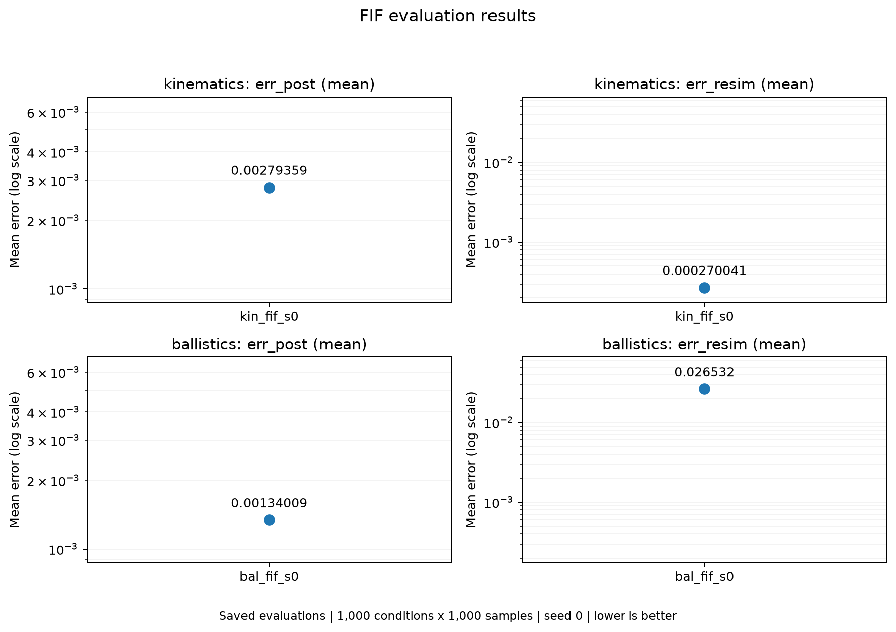

# FIF results

This report compares the saved test results of `kin_fif_s0` and `bal_fif_s0`.
The figures and tables were generated from existing evaluation files;
training and evaluation were not rerun.

## Test results

Both models were evaluated on **1,000 test observations × 1,000 posterior
samples per observation**. The training and evaluation seeds are 0, and the
device is CUDA. The runs use the fixed benchmark priors and target
`p(x | y_star)`. They do not include the prior-conditioned extension
`p(x | y_star, c)`.

| Problem | Run | Mean Err_post | Mean Err_resim | Failed samples | Total sampling time |
|---|---|---:|---:|---:|---:|
| Kinematics | `kin_fif_s0` | 0.002793585 | 0.000270041 | 0% | 3040.08 ms |
| Ballistics | `bal_fif_s0` | 0.001340090 | 0.026532042 | 0% | 3273.69 ms |

The times cover **generating all 1,000 × 1,000 samples** in the table.
They exclude training and metric computation.



The figure uses point plots in the same style as the autoencoder report.
The top row shows kinematics and the bottom row shows ballistics;
the left column shows `Err_post` and the right column shows `Err_resim`.
The vertical axes are logarithmic, with the same range for both problems
within each column. Each point represents a test mean, rather than an epoch
in a training curve.

## What do the errors measure?

- **Err_post:** The unbiased IMQ MMD² estimate between generated parameter
  samples and reference posterior samples, computed in raw parameter units.
  For the same problem and evaluation protocol, a lower value indicates a
  closer match to the reference distribution under this metric.
- **Err_resim:** The mean squared distance between the output obtained by
  passing generated parameters through the true simulator and the target
  observation: `mean(||f(x) - y_star||²)`. A lower value indicates that the
  samples reproduce the target observation more closely.

The table and figure use the mean of the per-condition errors. Applying the
recorded `clamp = 10` leaves both runs' means unchanged. `err_post_biased` is
a separate MMD² estimate and should be kept distinct from the `Err_post`
reported here. The unbiased estimate can be negative for individual conditions.

## Comparing kinematics and ballistics

**Posterior error:** Ballistics has a lower raw mean `Err_post`, but a higher
median. Some observations with large errors raise the kinematics mean:

| Problem | Median Err_post | Maximum Err_post | Median Err_resim |
|---|---:|---:|---:|
| Kinematics | 0.000429334 | 0.091130372 | 0.000205954 |
| Ballistics | 0.001087937 | 0.008297377 | 0.028302289 |

The mean alone therefore does not establish better overall posterior recovery
for ballistics. The two problems have different parameter distributions and
scales; raw MMD² is not a shared accuracy percentage across problems.

**Re-simulation error:** The raw mean `Err_resim` for ballistics is approximately
**98.25 times** the kinematics value. In these records, the error in reproducing
the target output is substantially higher for ballistics. However, kinematics
measures a two-dimensional endpoint, whereas ballistics measures a
one-dimensional impact position. Their reference observation-noise widths are
also different: `sigma = 0.01` and `sigma = 0.02`, respectively. This ratio
should not be interpreted as a normalized accuracy ratio across problems.

Both models have a failed-simulation rate of 0%. This means that the simulator
returns a defined output for the generated parameters; it does not by itself
show that the output is close to the target.

The initial speed in ballistics is a discrete, Poisson-distributed variable.
The current FIF uses a continuous approximation by adding `U(-0.5, 0.5)` noise
to the speed during training, then rounding sampled speeds to integers and
clamping them to nonnegative values. This is an approximation rather than an
exact discrete likelihood model. This approximation and the simulator's
discrete time grid are relevant limitations; the saved metrics alone do not
identify the cause of the larger error. The results also cover only one
training seed.

## Training summary

Both runs used 1,000,000 training pairs and 20,000 validation pairs, a batch
size of 1,000, 50 epochs, and an initial learning rate of 0.001. Checkpoint
selection used validation re-simulation error; test results were not used
for selection.

| Problem | Parameter count | Latent dimension | Selected epoch | Best validation resim |
|---|---:|---:|---:|---:|
| Kinematics | 2,996,080 | 2 | 48 | 0.000208860 |
| Ballistics | 2,994,739 | 3 | 48 | 0.027597337 |

Validation values come from a different data split and sampling procedure;
they should not be treated as the same measurement as the test `Err_resim`.

## Choosing the training architecture

The saved results above use the original `--arch mlp` architecture. A new
`--arch paper` option follows the tabular architecture in
[Appendix E.2 of the FIF paper](https://arxiv.org/html/2306.01843v5#A5.SS2),
adapted to our conditional inverse problems. No benchmark results for this
new option have been generated yet.

| Setting | `--arch mlp` (default) | `--arch paper` |
|---|---|---|
| Activation | SiLU | ReLU |
| Hidden layers per MLP | 4 | 2 |
| Default hidden width | Largest width within the parameter budget | Largest width within the parameter budget |
| Encoder | Conditional MLP | Conditional MLP, then 2 latent residual blocks |
| Decoder | Conditional MLP | 2 latent residual blocks, then conditional MLP |
| Normalization layers | None | None |

Each residual block has two hidden layers and maps the latent space back to
itself: `R(u, t) = u + B(u, t)`. Encoder and decoder weights are separate.
The clean simulator output `t` conditions every hidden layer through the same
scale-and-shift mechanism as the original model. All Jacobians hold `t` fixed.
Thus the new networks implement `e(x,t) = R_e(A_e(x,t),t)` and
`g(z,t) = A_g(R_g(z,t),t)` within the existing conditional FIF formulation.

The switch changes the architecture. The benchmark training defaults remain
Adam, cosine learning-rate scheduling, `beta = 100`, and an exact trace.
The paper's stochastic trace estimator and tabular training recipe are not
enabled by this switch. The fixed priors, KDE observation-noise bridge, and
ballistics speed approximation also remain in use.

To train the new architecture:

```powershell
.\.venv\Scripts\python.exe experiments/train_fif.py --problem kinematics --arch paper --run kin_fif_p3_s0 --device cuda
.\.venv\Scripts\python.exe experiments/train_fif.py --problem ballistics --arch paper --run bal_fif_p3_s0 --device cuda
```

These commands create `kin_fif_p3_s0` and `bal_fif_p3_s0`, preserving earlier
smaller paper runs. Without `--run`, paper runs still default to `kin_fif_p_s0`
or `bal_fif_p_s0`. The original architecture remains available with `--arch mlp`,
or by omitting `--arch`. Use `--run` to choose another short name; existing
output folders are never overwritten.
The selected architecture is saved in `config.json` and restored automatically
by `experiments/evaluate_fif.py`, including support for older MLP checkpoints
whose configurations have no `arch` field.

Training refuses to start if its output folder already exists, preserving the
previous best checkpoint and logs. To train again with the same seed, provide
a new `--run` name. Kinematics and ballistics have separate run folders.

Evaluation writes inside the selected run: first to `evaluation/`, then to
`evaluation_2/`, `evaluation_3/`, and so on on repeated invocations. Existing
evaluation files and checkpoints are preserved. The chosen output folder is
printed in the terminal. To evaluate the paper variants after training:

```powershell
.\.venv\Scripts\python.exe experiments/evaluate_fif.py kin_fif_p3_s0 --device cuda
.\.venv\Scripts\python.exe experiments/evaluate_fif.py bal_fif_p3_s0 --device cuda
```

Use `--hidden`, `--layers`, and `--blocks` to customize the new architecture.
`--layers` controls the hidden-layer count in both the main MLP and each
residual block; `--blocks` applies only to `--arch paper`. Both architectures
now automatically choose the largest integer hidden width within the default
3,000,000-parameter budget, unless `--hidden` is explicitly provided:

| Problem | Original MLP parameters | Paper width | Paper parameters |
|---|---:|---:|---:|
| Kinematics | 2,996,080 | 697 | 2,992,932 |
| Ballistics | 2,994,739 | 698 | 2,991,647 |

Integer widths make these counts approximately, rather than exactly, 3 million.
The early paper preset used width 256 (421,902 parameters for kinematics and
418,323 for ballistics). Existing runs and checkpoints keep their recorded
architecture; this correction affects new training runs only. To reproduce
the smaller preset explicitly, pass `--hidden 256`.

Architecture comparisons should match parameter budgets, data, training
schedule, and evaluation settings. Since the paper variant also changes the
activation and depth, this compares complete architectures; it does not
isolate the effect of residual blocks alone.

## Sources and recreating the figure

- Kinematics: [test results](../../experiments/runs/kin_fif_s0/evaluation/summary.json),
  [training summary](../../experiments/runs/kin_fif_s0/summary.json),
  [configuration](../../experiments/runs/kin_fif_s0/config.json).
- Ballistics: [test results](../../experiments/runs/bal_fif_s0/evaluation/summary.json),
  [training summary](../../experiments/runs/bal_fif_s0/summary.json),
  [configuration](../../experiments/runs/bal_fif_s0/config.json).
- [Figure data and source paths](fif.json).
- [Shared metric code](../../metrics/evaluate.py).

The minimum reference posterior sample count per condition is 444 for
kinematics and 111 for ballistics; not every condition has 1,000 reference
samples. This difference matters when interpreting MMD estimation uncertainty.

To plot the saved results from the repository root:

```powershell
.\.venv\Scripts\python.exe experiments/plot_fif.py
```

The [plotting script](../../experiments/plot_fif.py) generates `fif.png` and
`fif.json` in this folder using saved results, without loading a model or
running training or evaluation.
