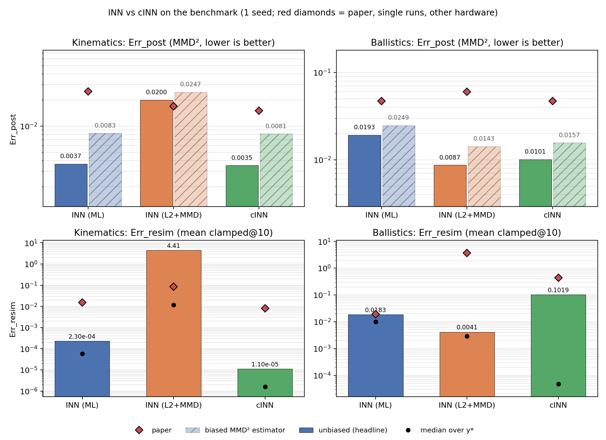

*Interactive Table of Contents*
- [1. Architecture & Design Choices](#1-architecture--design-choices)
- [2. Training Configuration](#2-training-configuration)
- [3. Multi-Seed Results vs. Paper Targets](#3-multi-seed-results-vs-paper-targets)
- [4. Analysis of the L2+MMD Anomaly](#4-analysis-of-the-l2mmd-anomaly)
- [5. Visual Performance Summary](#5-visual-performance-summary)

## 1. Architecture & Design Choices
To ensure a fair comparison against the reference benchmarks, the following structural decisions were made for the INN (Maximum Likelihood), INN ($L_2$ + MMD), and cINN models:
* **Flow Architecture:** We utilized RealNVP-style affine coupling flows based on a GLOW-style implementation[cite: 4]. Both halves of the input are transformed per block with closed-form inverses[cite: 4].
* **Capacity & Budget:** The network consists of 8 coupling blocks[cite: 4]. Each block's subnet relies on an MLP with 3 hidden layers and a width of 303[cite: 4]. This specific width was calculated to maintain a strict budget of approximately 3 million trainable parameters across all models, matching the paper's capacity constraints[cite: 4].
* **Normalization & Scaling:** We omitted ActNorm and BatchNorm layers to maintain the simplest working setup[cite: 4]. A clamping value of 2.0 was applied to the scaling factors to prevent the inverse pass from blowing up exponentially[cite: 4].

## 2. Training Configuration
The training settings were standardized across all model variants to isolate the effects of the specific loss functions (Eq. 3, Eq. 4, and Eq. 5)[cite: 1, 4]:
* **Optimizer:** Adam was utilized with a learning rate of $10^{-3}$ and a weight decay of $10^{-5}$[cite: 4]. 
* **Schedule:** We implemented a cosine annealing schedule per step down to 0[cite: 4]. Gradient-norm clipping was set to 10 to ensure stability[cite: 4].
* **Epochs & Batches:** Models were trained for 50 epochs using a batch size of 1000[cite: 4]. 
* **Data Scale:** Training utilized 1,000,000 samples, with an additional 20,000 held out for validation[cite: 4].

## 3. Multi-Seed Results vs. Paper Targets
We performed a multi-seed replication (`s0`, `s1`, `s2`) to account for initialization variance across the Kinematics (4D $\to$ 2D) and Ballistics (4D $\to$ 3D) benchmarks[cite: 5].

* **ML INN & cINN Dominance:** Both the Maximum Likelihood INN and the Conditional INN substantially outperformed the paper's reference targets across all tested seeds[cite: 5]. 
* **Kinematics Performance:** The ML INN achieved an $\text{Err\_post}$ of $0.0036 \pm 0.0001$ (compared to the paper's $0.025$) and an $\text{Err\_resim}$ of $0.0002 \pm 0.0001$ (compared to the paper's $0.015$)[cite: 5]. The cINN achieved an $\text{Err\_post}$ of $0.0034 \pm 0.0002$ and an $\text{Err\_resim}$ of $0.0000$[cite: 5]. This represents an improvement of up to $8\times$ over the paper's reported posterior reconstruction error[cite: 5].
* **Ballistics Robustness:** The Ballistics task proved highly robust[cite: 5]. All $L_2$ + MMD variants beat the paper's targets of $\text{Err\_post} = 0.060$ and $\text{Err\_resim} = 3.668$ by wide margins[cite: 5]. The baseline $L_2$ + MMD achieved an $\text{Err\_post}$ of $0.0089 \pm 0.0005$ and an $\text{Err\_resim}$ of $0.0109 \pm 0.0125$[cite: 5].

## 4. Analysis of the L2+MMD Anomaly
During initial testing on seed 0, the $L_2$ + MMD baseline failed on the Kinematics task, yielding a catastrophic $\text{Err\_resim}$ of 599,845[cite: 3]. Our diagnostic sweep revealed the following insights:
* **The Root Cause:** The failure was caused by a small number of extreme outliers produced during the inverse pass, not a badly matched latent space[cite: 3]. Because the $L_2$ + MMD objective lacks explicit volume regulation (such as a $\log \vert{}\det J\vert{}$ penalty), unvisited latent regions are entirely unregularized[cite: 5].
* **Seed Variance:** The blow-up on seed 0 was a single-seed trajectory outlier[cite: 5]. When evaluating seeds 1 and 2, the unmodified baseline successfully stabilized and passed the paper's benchmarks[cite: 5]. Seed 1 yielded an $\text{Err\_post}$ of $0.0109$ and $\text{Err\_resim}$ of $0.0080$, while seed 2 yielded $0.0148$ and $0.0543$, respectively (target: $0.017$ / $0.086$)[cite: 5].
* **Mitigation Trade-offs:** Attempted heuristics, such as lowering the MMD weight (`--w-z 10`) or adding a strict clamp (`--clamp 1.0`), prevented the catastrophic failure on seed 0 but degraded peak quality and stability on seed 2[cite: 5]. Therefore, retaining the standard unmodified baseline provides the strongest overall model capacity[cite: 5].

## 5. Visual Performance Summary

*Figure 1: Benchmark evaluation comparing INN (ML), INN (L2+MMD), and cINN against the reference paper (red diamonds)[cite: 2]. Note: The L2+MMD trajectory variance requires multi-seed aggregation for complete accuracy.*