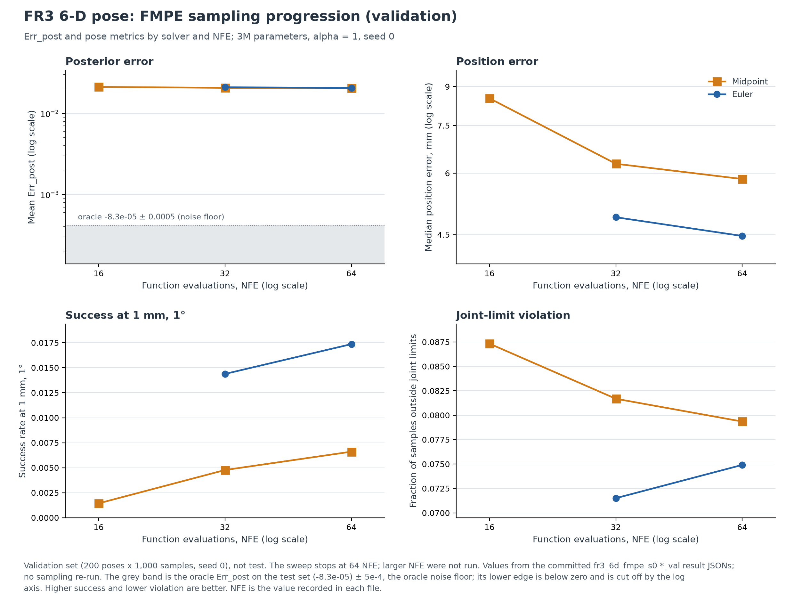
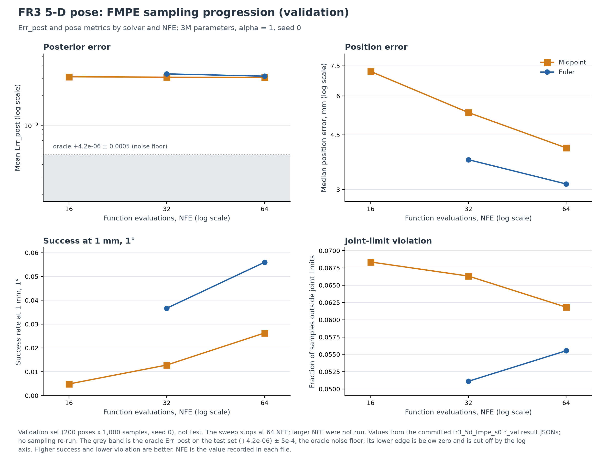
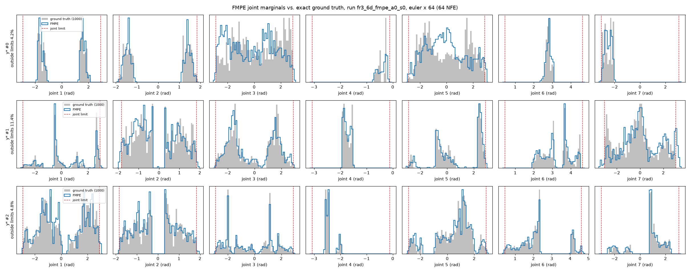
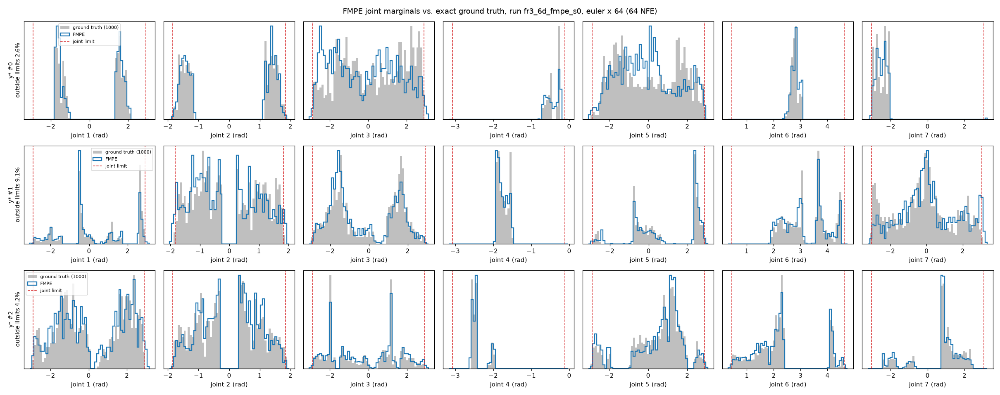
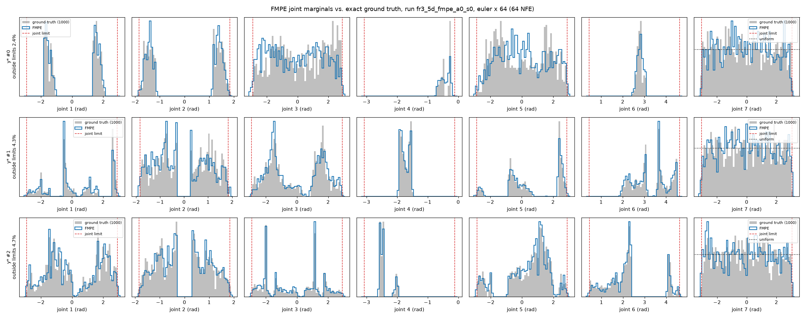
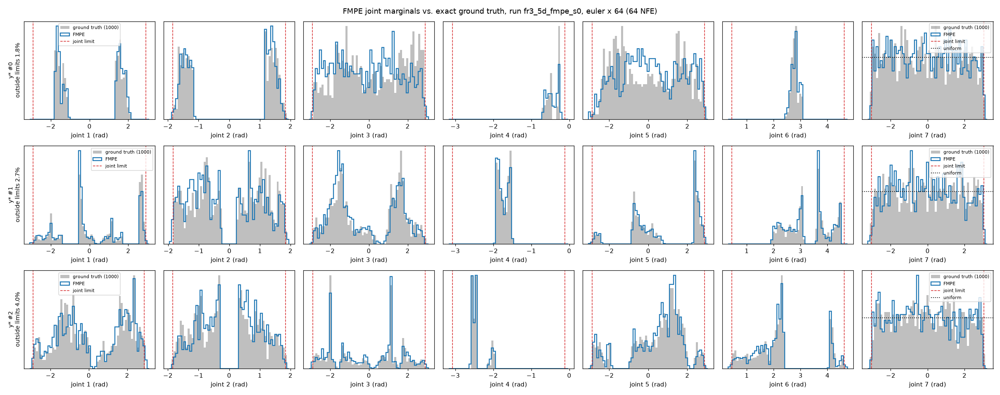

# FMPE on FR3: follow-up (ODE progression, α = 0 control, model size, group error plots)

Follow-up to `docs/reports/2026-11-11_fr3-fmpe.md` (first FR3 FMPE report). It adds the analyses that
report did not have. Part A: the ODE progression from the committed validation sweep, and the α = 0
control. Part B: model size and the FR3 group train/test error figures (FMPE, Euclidean FFF, M-FFF).
The FFF / M-FFF numbers come from `docs/reports/2026-11-11_fr3-fff-mfff.md` (PR #22, on `main`).

**Machine.** Same laptop as the first report: NVIDIA GeForce RTX 3060 Laptop GPU (6 GB), CUDA 12.6,
PyTorch 2.14.1+cu126, Windows 11, Python 3.12, `--device cuda`. All GPU jobs in this report ran one
after another, never two at once.

**Ground truth.** The four ground-truth files were checked against the sha256 table of the first
report before any evaluation. All four match (`gt_fr3_6d_..._3297457ebd`, `..._fb7720ec0b`,
`gt_fr3_5d_..._068e186e5c`, `..._f0b43cd65f`). None were regenerated.

**Code changes** (no change to `models/fmpe.py`; default runs of all scripts are unchanged):

- `experiments/plot_analysis.py --fr3`: adds the FR3 ODE progression (`plot_ode_fr3`) and the
  α = 0 / α = 1 learning-curve figure (`*_alpha`). The existing `loglog_learning_curve_fmpe_fr3_*`
  figures are left as committed.
- `experiments/plot_fmpe_posterior.py`: `--device`, FR3 figures also as `.svg`, and
  `--joint7 RUN ...` for the pooled joint-7 histogram on `fr3_5d` (FMPE runs and ground truth).
- `experiments/fmpe_tail_divergence.py` (new): tail stress test for diverging samples (see A2).
- `experiments/plot_group_errors.py --fr3`: FR3 group error figures (Part B2).

---

# Part A

## A1. ODE progression on FR3 (validation, no new runs)

Built from the committed α = 1 validation sweep (`metrics/results/fr3_{6d,5d}_fr3_{6d,5d}_fmpe_s0_*_val.json`,
200 poses × 1000 samples). Four panels: Err_post mean (with the oracle ± 5e-4 noise band),
`pos_err_mm` median, success at 1 mm / 1°, and joint-limit violation.

- `experiments/figures/fmpe/ode_progression/ode_progression_fmpe_fr3_6d.{png,svg}`
- `experiments/figures/fmpe/ode_progression/ode_progression_fmpe_fr3_5d.{png,svg}`

On both tasks the Err_post lines of Euler and midpoint are flat and within 5e-4 of each other from 16 to
64 NFE, and every value is far above the oracle band (about 40× on 6-D, 6× on 5-D). The solver choice
shows only in the pose metrics: at equal NFE, Euler has a lower median position error (4.47 vs 5.84 mm
on 6-D at 64 NFE), 2–3× the 1 mm / 1° success rate, and a lower joint-limit violation. All of these
improve with NFE up to the end of the sweep at 64 NFE, except the Euler violation fraction, which rises
slightly from 32 to 64 NFE.

## A2. α = 0 control

### Training

`python experiments/train_fmpe.py --problem <task> --alpha 0 --seed 0 --device cuda --run-name <task>_fmpe_a0_s0`,
everything else as for the α = 1 runs.

| Run | Parameters | Train time | Final train / val loss | Val loss at epochs 1, 10, 20, 30, 40, 50 | Val log-log slope, epochs 30–50 |
|---|---|---|---|---|---|
| `fr3_6d_fmpe_a0_s0` | 2,997,335 | 470 s | 4.453 / 4.491 | 6.36, 5.09, 4.87, 4.67, 4.54, 4.49 | −0.083 |
| `fr3_5d_fmpe_a0_s0` | 2,995,847 | 454 s | 5.584 / 5.626 | 6.98, 6.09, 5.92, 5.77, 5.66, 5.63 | −0.053 |

The lowest validation loss is at epoch 50 in both runs; both were still improving. The α = 0 losses
average the flow-matching error over a uniform time distribution, the α = 1 losses over p(t) ∝ t, so
the loss levels of the two α are not comparable. The train times are not comparable with the α = 1 runs
either (970 s / 930 s), because those ran with the GPU shared.

Learning curves, α = 0 and α = 1 on separate panels:
`experiments/figures/fmpe/learning_curves/loglog_learning_curve_fmpe_fr3_6d_alpha.{png,svg}` and
`..._fr3_5d_alpha.{png,svg}`.

### Validation sweep (α = 0)

`python experiments/evaluate_fmpe.py <run> --split val --solver <setting> --device cuda`, one setting at a
time, **without** `--redraw-nonfinite`. No setting stopped: all 10 × 200,000 samples were finite.
Same rule as the first report: keep settings with Err_post within 5e-4 of the best, choose the highest
success at 1 mm / 1°, then lower error medians, then fewer NFE.

#### `fr3_6d` (val, α = 0)

| Setting | NFE | Err_post mean | vs best | Kept | Err_resim mean | pos_err_mm median / p95 | rot_err_deg median | success 1 mm, 1° | success 10 mm, 5° | joint-limit violation | coverage (δ = 0.1) |
|---|---|---|---|---|---|---|---|---|---|---|---|
| midpoint × 8 | 16 | 0.02287 | +0.00068 | no | 0.00877 | 11.11 / 29.67 | 2.30 | 0.0005 | 0.400 | 0.0895 | 0.939 |
| midpoint × 16 | 32 | 0.02238 | +0.00018 | yes | 0.00619 | 9.08 / 22.95 | 1.98 | 0.0008 | 0.521 | 0.0850 | 0.943 |
| midpoint × 32 | 64 | 0.02225 | +0.00005 | yes | 0.00708 | 10.41 / 27.71 | 2.35 | 0.0005 | 0.438 | 0.0824 | 0.937 |
| **Euler × 32** | 32 | 0.02261 | +0.00042 | yes | 0.00747 | **6.68 / 19.95** | **1.51** | **0.0041** | **0.695** | **0.0745** | 0.943 |
| Euler × 64 | 64 | **0.02219** | 0 | yes | 0.00653 | 7.12 / 21.89 | 1.72 | 0.0033 | 0.649 | 0.0778 | 0.943 |

#### `fr3_5d` (val, α = 0)

| Setting | NFE | Err_post mean | vs best | Kept | Err_resim mean | pos_err_mm median / p95 | axis_err_deg median | success 1 mm, 1° | success 10 mm, 5° | joint-limit violation | coverage (δ = 0.5) |
|---|---|---|---|---|---|---|---|---|---|---|---|
| midpoint × 8 | 16 | 0.00316 | +0.00004 | yes | 0.00176 | 8.97 / 24.14 | 1.25 | 0.0021 | 0.537 | 0.0786 | 0.973 |
| midpoint × 16 | 32 | 0.00313 | +0.00001 | yes | 0.00108 | 6.66 / 17.74 | 0.97 | 0.0061 | 0.711 | 0.0711 | 0.974 |
| midpoint × 32 | 64 | **0.00313** | 0 | yes | 0.00114 | 6.39 / 19.20 | 1.04 | 0.0070 | 0.715 | 0.0684 | 0.974 |
| Euler × 32 | 32 | 0.00334 | +0.00021 | yes | 0.00122 | 5.05 / 15.16 | 0.73 | 0.0147 | 0.823 | **0.0569** | 0.970 |
| **Euler × 64** | 64 | 0.00319 | +0.00006 | yes | **0.00101** | **4.70** / 15.35 | 0.75 | **0.0196** | **0.825** | 0.0616 | 0.972 |

**Would α = 0 choose a different sampler?** On `fr3_5d`, no: Euler × 64, as for α = 1. On `fr3_6d`, yes:
the rule picks **Euler × 32** (success 0.41% vs 0.33% for Euler × 64). With α = 0 the 6-D pose metrics get
*worse* from 32 to 64 NFE for both solvers (Euler 6.68 → 7.12 mm, midpoint 9.08 → 10.41 mm), which the
α = 1 model does not show. The test comparison below still uses Euler × 64 for both α, as the task asks,
so that α is the only difference.

### Test, Euler × 64

`python experiments/evaluate_fmpe.py <run> --solver euler:64 --device cuda --redraw-nonfinite`
(1000 poses × 1000 samples, seed 0). The α = 1 rows are the committed results of the first report.

#### `fr3_6d` (test)

| | Err_post mean | median | Err_resim mean | pos_err_mm median / p95 | rot_err_deg median | success 1 mm, 1° | success 10 mm, 5° | joint-limit violation | coverage (δ = 0.1) | redrawn (seed 0 / seed 1) | calibration (marginal, joint, spread) |
|---|---|---|---|---|---|---|---|---|---|---|---|
| Oracle | −0.00008 | −0.00017 | 2.3e-14 | 3.3e-5 / 7.1e-5 | 6.1e-6 | 1.000 | 1.000 | 0.000 | 0.995 | – | – |
| FMPE α = 1 | **0.02207** | **0.00989** | **0.00493** | **4.57 / 14.32** | **1.11** | **0.0170** | **0.822** | 0.0841 | **0.967** | 1 / 0 | calibrated, calibrated, calibrated |
| FMPE α = 0 | 0.02378 | 0.01118 | 0.00936 | 7.36 / 22.66 | 1.78 | 0.0029 | 0.629 | 0.0846 | 0.945 | 0 / 0 | calibrated, calibrated, calibrated |

Seed-1 test results (Euler × 64, `--seed 1`, separate `--name`): α = 1 Err_post 0.02227, α = 0 0.02396
(difference +0.00169, the same as with seed 0: +0.00171). Files:
`metrics/results/fr3_6d_fr3_6d_fmpe_s0_evalseed1_eulerx64.json`, `..._fmpe_a0_s0_evalseed1_eulerx64.json`.

#### `fr3_5d` (test)

| | Err_post mean | median | Err_resim mean | pos_err_mm median / p95 | axis_err_deg median | success 1 mm, 1° | success 10 mm, 5° | joint-limit violation | coverage (δ = 0.5) | redrawn | calibration (marginal, joint, spread) |
|---|---|---|---|---|---|---|---|---|---|---|---|
| Oracle | 0.000004 | −0.00005 | 1.2e-14 | 3.2e-5 / 7.1e-5 | 4.6e-6 | 1.000 | 1.000 | 0.000 | 0.982 | – | – |
| FMPE α = 1 | **0.00319** | **0.00126** | **0.00051** | **3.30 / 10.25** | **0.49** | **0.0506** | **0.902** | **0.0600** | 0.975 | 0 | calibrated, calibrated, calibrated |
| FMPE α = 0 | 0.00325 | 0.00135 | 0.00104 | 4.90 / 15.85 | 0.78 | 0.0178 | 0.811 | 0.0651 | 0.974 | 0 | calibrated, calibrated, calibrated |

Inference time (Euler × 64, 10⁶ samples, RTX 3060 Laptop, GPU not shared): α = 0 102.7 s (6-D) and
102.8 s (5-D); α = 1 100.1 s and 100.9 s. Same network size, so as expected the same.

### Calibration (α = 0)

`python experiments/evaluate_calibration.py auto <run> --solver euler:64 --device cuda` (1000 test poses × 1000 samples).

| Run | Poses used | Marginal | signed error | KS p | Joint | signed error | KS p | Spread / ground truth (median) | Spread verdict |
|---|---|---|---|---|---|---|---|---|---|
| `fr3_6d_fmpe_a0_s0` | 1000 of 1000 | calibrated | −0.007 | 0.19 | calibrated | +0.022 | 0.034 | 0.993 (0% too narrow, 0.3% too wide) | calibrated |
| `fr3_5d_fmpe_a0_s0` | 1000 of 1000 | calibrated | −0.007 | 0.18 | calibrated | +0.007 | 0.71 | 0.989 (0% too narrow, 0.2% too wide) | calibrated |

Every joint is calibrated on its own on both tasks. No sample was non-finite, so no pose was dropped
(α = 1 on `fr3_6d` lost one pose here to the divergence). On `fr3_6d` the joint KS p of 0.034 is lower
than for α = 1 (0.26); the script's verdict, which uses the signed error, is still "calibrated".

### Diverging samples

| | α = 1 | α = 0 |
|---|---|---|
| `fr3_6d` test, seed 0 (10⁶ samples), redrawn | 1 | 0 |
| `fr3_6d` test, seed 1 (10⁶ samples), redrawn | 0 | 0 |
| `fr3_5d` test, seed 0 (10⁶ samples), redrawn | 0 | 0 |
| validation sweeps, without redraw (5 × 2 × 200,000 samples) | all finite | all finite |
| **tail stress test `fr3_6d`**: 500,000 x(0) with \|x(0)\| > 4.5, Euler × 64, non-finite | **32** | **0** |
| tail stress test `fr3_5d`, same x(0), non-finite | 0 | 0 |

- The seed-1 count for α = 1 is 0 here, the first report found 2 with seed 1. These are different draws:
  `evaluate_fmpe.py` resets the seed and `metrics.evaluate` then makes three warm-up sampling calls
  before the scored one, while the first report's seed-1 count came from a separate diagnostic run.
  At about one divergence per 10⁶ samples, the test runs alone cannot separate the two α (1 event vs 0).
- So a direct test was added: `python experiments/fmpe_tail_divergence.py fr3_6d_fmpe_s0 fr3_6d_fmpe_a0_s0
  --n 500000 --radius 4.5 --device cuda` (and the same for 5-D). It draws 500,000 starting points from the
  tail of x(0) only (N(0, I) given |x(0)| > 4.5, the region where the α = 1 divergence started; 0.5% of all
  draws), pairs them with the 1000 test poses in turn, and integrates them with both models: the **same**
  x(0) and y* for both. Results: `metrics/results/fr3_{6d,5d}_fmpe_tail_divergence_r4.5.json`.
- With α = 1, 32 of these 500,000 diverge on 6-D (6.4e-5), spread over 26 different poses, all with
  |x(0)| ≥ 4.69. With α = 0, none diverge, and none end with |x| > 10 rad. If both had the same rate, 0
  of 500,000 against 32 would have a probability of about e⁻³² — so the difference is real.
  On 5-D neither model diverges.
- Implied overall α = 1 rate on 6-D: 0.005 × 6.4e-5 ≈ 3e-7 per sample, which fits 1 + 0 events in 2 × 10⁶
  test samples. The first report's estimate for |x(0)| > 4.5 (0.1–0.2%) was higher; it came from a smaller
  diagnostic and is not reproduced by this test.

### Posterior figures

3 test poses (0, 1, 2), Euler × 64, the shared FR3 drawing function `fr3_marginals_figure`:

- α = 0: `experiments/figures/fmpe/posterior/fmpe_posterior_fr3_6d_fmpe_a0_s0.{png,svg}`,
  `..._fr3_5d_fmpe_a0_s0.{png,svg}`
- α = 1 (first report): `experiments/figures/fmpe/posterior/fmpe_posterior_fr3_6d_fmpe_s0.png`, `..._fr3_5d_fmpe_s0.png`

| α = 0 | α = 1 |
|---|---|
|  |  |
|  |  |

Both α find the same modes and gaps; the visible difference is that α = 0 puts more mass between and
beyond the modes (e.g. joint 5 of 6-D pose 0, where α = 0 fills the dip around 0) and more outside the
limits: 4.2%, 11.4%, 4.8% of samples for poses 0–2 on 6-D (α = 1: 2.6%, 9.1%, 4.2%) and 2.4%, 4.3%, 4.7%
on 5-D (α = 1: 1.8%, 2.7%, 4.0%).

**`fr3_5d` free joint 7**, pooled over all 1000 test poses × 1000 samples
(`python experiments/plot_fmpe_posterior.py fr3_5d_fmpe_a0_s0 --solver euler:64 --device cuda --joint7 fr3_5d_fmpe_s0 fr3_5d_fmpe_a0_s0`):
`experiments/figures/fmpe/posterior/fr3_5d_joint7_fmpe_alpha.{png,svg}`.

| | KS vs uniform per pose, median / p95 | outside limits | inner 18 of 20 bins / flat level | two edge bins / flat level |
|---|---|---|---|---|
| FMPE α = 1 | 0.029 / 0.047 | 0.45% | 0.96–1.04 | 0.82, 0.86 |
| FMPE α = 0 | 0.029 / 0.047 | 0.58% | 0.99–1.05 | 0.82, 0.83 |
| Ground truth (1000 draws per pose) | 0.027 / 0.043 | 0% | 0.99–1.01 | 1.00, 1.00 |

The α = 1 row reproduces the first report's numbers. Both α learn the flat marginal equally well
and share the soft edge at the limits; α = 0 leaks slightly more mass past them.

## Part A answer

- **Does α = 0 remove the divergence?** Yes, on the evidence available. On the paired tail stress test
  (500,000 identical tail starting points on `fr3_6d`), α = 1 diverges 32 times and α = 0 never. The test
  sets show the same direction (1 vs 0 redraws over 2 × 10⁶ samples each) but are too small to show it
  on their own. This supports the first report's guess that the α = 1 field is under-trained near t = 0
  in the tails of x(0).
- **Does it change accuracy beyond the 5e-4 oracle noise?** On `fr3_6d`, yes, for the worse: Err_post
  mean +0.0017 (0.02378 vs 0.02207, the same with seed 1), more than 3× the noise floor, and the pose
  metrics are clearly worse (median position error 7.36 vs 4.57 mm, 1 mm / 1° success 0.29% vs 1.70%).
  On `fr3_5d`, Err_post is within the noise (+0.00006), but the pose metrics are again clearly worse
  (4.90 vs 3.30 mm, 1.78% vs 5.06%) and Err_resim doubles. Calibration is fine for both α.
- So α = 0 trades a ~3e-7-per-sample divergence for a large loss of pose precision. Part B uses **α = 1**.

---

# Part B

(follows)
