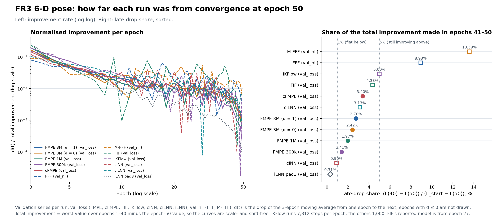
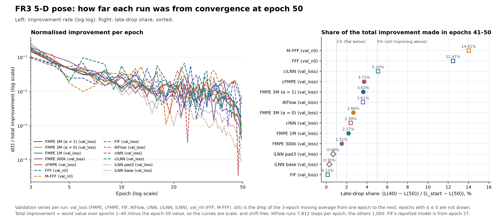
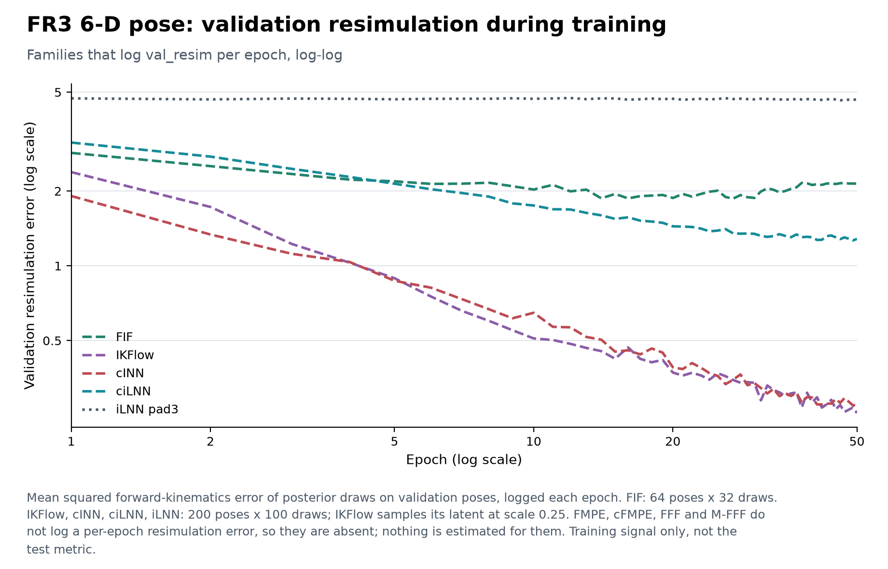
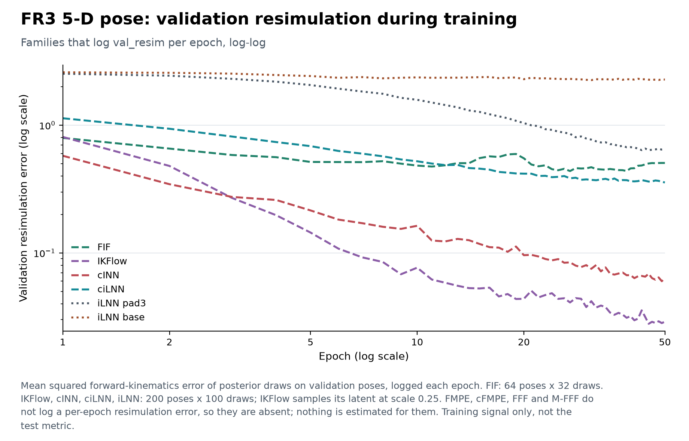

# FR3: log-log analysis of the training curves of every model family

**Answer.** At epoch 50, FFF and M-FFF were the only runs still clearly improving on both tasks: 9–14% of
their total validation-NLL improvement came in the last 10 epochs. ciLNN on `fr3_5d` (5.1%) and IKFlow on
`fr3_6d` (5.0%) sit at the 5% line. The iLNN runs (`pad3`, `base`), FIF on `fr3_5d` and cINN on `fr3_6d`
had flattened (below 1%), and FIF's validation resimulation was worse at epoch 50 than at epoch 27 on
both tasks. Every FMPE and cFMPE run was still falling but slowing down (1.4–3.7%, log-log slopes over
epochs 30–50 from −0.05 to −0.22).

No training, sampling or evaluation was run for this report. Everything comes from the committed
`experiments/runs/fr3_*/log.csv`, `config.json` and `summary.json` files. The test numbers quoted in
section 4 come from the committed `metrics/results/fr3_*.json` files.

**Files added** (nothing existing was changed):

- `experiments/fr3_loglog.py`: reads the logs and writes everything below. It reuses `loglog_slope`,
  `committed`, `finish`, `log_ticks`, `log_limits` and `fixed_x_ticks` from `experiments/plot_analysis.py`,
  and `COLORS`, `save_figure` and `style_axis` from `experiments/plot_group_errors.py`. Neither of those
  files was edited.
- `metrics/analysis/fr3_loglog.csv`: one row per (task, run, series), 86 rows.
- Per-family figures `experiments/figures/<folder>/learning_curves/loglog_learning_curve_<family>_<task>.{png,svg}`
  for cFMPE (`cfmpe/`), FFF / M-FFF (`fff/`), FIF (`fif/`), IKFlow (`ikflow/`), cINN (`inn/`), and
  ciLNN and iLNN (`ilnn/`). The FMPE FR3 log-log figures and the FFF three-panel learning curves were
  left as committed.
- `experiments/figures/shared/comparison/fr3_loglog_<task>.{png,svg}` and
  `experiments/figures/shared/comparison/fr3_loglog_resim_<task>.{png,svg}`.

Reproduce with `python experiments/fr3_loglog.py` (inside the project `.venv`).

## Runs and log checks

Included runs, with the `fr3_6d_` / `fr3_5d_` prefix: `fmpe_s0`, `fmpe_a0_s0`, `fmpe_p1000000_s0`,
`fmpe_p300000_s0`, `cfmpe_s0`, `fff_b400_s0`, `mfff_wrapped_b400_s0`, `fif_s0`, `ikflow`, `cinn`, `cilnn`,
`pad3` (both tasks) and `base` (`fr3_5d` only). That is 12 runs on `fr3_6d` and 13 on `fr3_5d`. Smoke
runs, `fr3_6d_ikf_ref`, the `fr3_6d_ikf_p1_*` tuning runs, `fr3_6d_ikflow_long` (empty log) and the two
FFF y-noise runs were left out.

**Epoch check.** Every included log has exactly 50 rows. Two logs do not number them 0–49:
`fr3_6d_fif_s0` and `fr3_5d_fif_s0` number them **1–50**, because `train_fif.py` writes its loop
counter `range(1, 51)`. There are no gaps, so these are 50 consecutive epochs. The script maps both
conventions to epochs 1–50. Every other log is 0–49.

`fr3_6d_pad3` has a log, so it is in this analysis, but it has **no committed test result**, so it does
not appear in the result tables.

**Signs.** I checked the sign of every series. Differences from the expected table:

- iLNN `pad3` and `base`: `train_loss`, `val_loss`, `val_nll` and `val_resim` are all **strictly
  positive** (lowest values are 0.235 for `fr3_5d_pad3` and 31.1 for `fr3_6d_pad3`). `val_nll` is
  identical to `val_loss` in all three logs, so the figures draw it once.
- FFF / M-FFF: `val_loss` is positive on both tasks, not signed. It still rises first: the best value is
  at epoch 1 and it peaks between epochs 10 and 30. `val_nll` is signed (+10 to +11 at epoch 1, −2.7 to
  −7.8 at epoch 50). `val_recon` is positive but **also rises first** (M-FFF `fr3_6d`: 0.00142 at epoch 1,
  0.00195 at epoch 50).
- FIF: every series is positive, including `val_latent` and `val_trace`. Neither of those two is
  monotone.
- IKFlow, cINN, ciLNN: `train_loss` and `val_loss` (NLL) are strictly negative, and `val_nll` equals
  `val_loss`. `val_resim` is positive. This matches the expected table.

**Which epoch the reported model comes from.** FIF saves `model.pt` at its best validation-resim epoch:
`summary.json` gives `best_epoch = 27` on both tasks, and the minimum of `val_resim` in the log is at epoch
27 on both tasks. Every other training script (`train_fmpe.py`, `train_conditional_fmpe.py`,
`train_fff.py`, `train_inn.py`, `train_ilnn.py`, `train_ikflow.py`) saves `model.pt` once, after the last
epoch. IKFlow has EMA off (`ema` is not in its config, and the default is 0). So every other reported
model is the epoch-50 model.

**Steps per epoch** (from the `step` column, constant within each run): IKFlow **7,812** (batch 128 on
1M pairs), every other run **1,000** (batch 1000). A log-log slope against epochs equals the slope against
steps, because the two differ by a constant factor. Levels at the same epoch are not levels after the same
number of updates: by epoch 50, IKFlow has made 390,600 updates and the others 50,000.

## Method

Epochs are counted from 1. All series are minimised.

1. **Direct log-log slope**: `loglog_slope` from `plot_analysis.py`, fitting log(value) against
   log(epoch) over epochs 1–5, 5–25, 25–50 and 30–50. It is computed only for strictly positive series.
   Check: FMPE `fr3_6d` 3M `val_loss` gives **−0.158** over epochs 30–50, the same as the FMPE report.
2. **Improvement-rate slope**: S = 3-epoch centred moving average, defined for epochs 2–49.
   d(t) = S(t−1) − S(t), defined for epochs 3–49. Fit log d against log t over epochs 25–50 (in practice
   25–49, 25 points), using only epochs with d > 0. k = −slope − 1 is a **model-based estimate**, valid
   only if L(t) ≈ a + b·t^(−k). The CSV gives the number of fitted epochs and the number with d ≤ 0.
   Fits with fewer than 15 epochs are marked ⚠.
3. **Late-drop share** = (L(40) − L(50)) / (L_start − L(50)), for validation series only.
   **L_start is the worst (largest) value over epochs 1–40.** For a series that falls throughout, that is
   L(1). For a series that rises first, it is the peak, and the CSV says so in `late_drop_start`. I did not
   use the minimum over epochs 1–40 as the task text suggests. For a falling series that minimum is L(40),
   which makes the share exactly 1. For a series that rises first (FFF `val_loss`) the minimum is L(1),
   which is below L(50), so the denominator turns negative. Using the worst level is the reading that
   measures "share of the total improvement". Labels: above 5% "still improving", below 1% "flat",
   otherwise "slowing".
4. **Best epoch**: the epoch of the lowest value of the series. The CSV also records `model_epoch`, the
   epoch `model.pt` comes from.

## Summary table (validation series, one row per run)

The validation series is `val_loss`, or `val_nll` for FFF / M-FFF. The last column summarises `val_resim`
where the run logs it. Every other series (train curves, FFF recon and total loss, FIF recon, latent and
trace terms, the 1–5, 5–25 and 25–50 slopes) is in `metrics/analysis/fr3_loglog.csv`.

### fr3_6d

| Run | Val series (sign) | Slope 30–50 | Rate slope (k) | Fit epochs / d ≤ 0 | Late-drop share | Label | Best epoch | Model epoch | Steps/epoch | val_resim: slope 30–50, late-drop, best epoch |
|---|---|---|---|---|---|---|---|---|---|---|
| `fr3_6d_fmpe_s0` | val_loss (positive) | −0.158 | −2.72 (1.72) | 25 / 0 | 2.76% | slowing | 50 | 50 | 1,000 | not logged |
| `fr3_6d_fmpe_a0_s0` | val_loss (positive) | −0.083 | −3.05 (2.05) | 25 / 0 | 2.42% | slowing | 50 | 50 | 1,000 | not logged |
| `fr3_6d_fmpe_p1000000_s0` | val_loss (positive) | −0.134 | −2.83 (1.83) | 25 / 0 | 1.97% | slowing | 50 | 50 | 1,000 | not logged |
| `fr3_6d_fmpe_p300000_s0` | val_loss (positive) | −0.108 | −3.21 (2.21) | 25 / 0 | 1.41% | slowing | 50 | 50 | 1,000 | not logged |
| `fr3_6d_cfmpe_s0` | val_loss (positive) | −0.221 | −2.74 (1.74) | 25 / 0 | 3.40% | slowing | 50 | 50 | 1,000 | not logged |
| `fr3_6d_fff_b400_s0` | val_nll (signed) | – | −1.16 (0.16) | 24 / 1 | 8.93% | still improving | 50 | 50 | 1,000 | not logged |
| `fr3_6d_mfff_wrapped_b400_s0` | val_nll (signed) | – | −0.53 (−0.47) | 23 / 2 | 13.59% | still improving | 50 | 50 | 1,000 | not logged |
| `fr3_6d_fif_s0` | val_loss (positive) | −0.909 | −4.94 (3.94) | 16 / 9 | 4.33% | slowing | 49 | **27** | 1,000 | 0.204, −3.9%, 27 |
| `fr3_6d_ikflow` | val_loss (negative) | – | −2.24 (1.24) | 22 / 3 | 5.00% | slowing (at the line) | 50 | 50 | **7,812** | −0.436, 1.3%, 50 |
| `fr3_6d_cinn` | val_loss (negative) | – | −5.36 (4.36) | 21 / 4 | 0.90% | flat | 46 | 50 | 1,000 | −0.313, 1.2%, 49 |
| `fr3_6d_cilnn` | val_loss (negative) | – | −1.57 (0.57) | 25 / 0 | 3.13% | slowing | 50 | 50 | 1,000 | −0.076, 1.1%, 49 |
| `fr3_6d_pad3` (no test result) | val_loss (positive) | −0.518 | −3.97 (2.97) | 25 / 0 | 0.31% | flat | 50 | 50 | 1,000 | −0.014, 35.6%*, 46 |

### fr3_5d

| Run | Val series (sign) | Slope 30–50 | Rate slope (k) | Fit epochs / d ≤ 0 | Late-drop share | Label | Best epoch | Model epoch | Steps/epoch | val_resim: slope 30–50, late-drop, best epoch |
|---|---|---|---|---|---|---|---|---|---|---|
| `fr3_5d_fmpe_s0` | val_loss (positive) | −0.088 | −2.20 (1.20) | 25 / 0 | 3.63% | slowing | 50 | 50 | 1,000 | not logged |
| `fr3_5d_fmpe_a0_s0` | val_loss (positive) | −0.053 | −2.94 (1.94) | 25 / 0 | 2.66% | slowing | 50 | 50 | 1,000 | not logged |
| `fr3_5d_fmpe_p1000000_s0` | val_loss (positive) | −0.076 | −2.74 (1.74) | 25 / 0 | 2.17% | slowing | 50 | 50 | 1,000 | not logged |
| `fr3_5d_fmpe_p300000_s0` | val_loss (positive) | −0.063 | −3.09 (2.09) | 25 / 0 | 1.51% | slowing | 50 | 50 | 1,000 | not logged |
| `fr3_5d_cfmpe_s0` | val_loss (positive) | −0.110 | −2.46 (1.46) | 25 / 0 | 3.72% | slowing | 50 | 50 | 1,000 | not logged |
| `fr3_5d_fff_b400_s0` | val_nll (signed) | – | −0.31 (−0.69) | 24 / 1 | 12.47% | still improving | 50 | 50 | 1,000 | not logged |
| `fr3_5d_mfff_wrapped_b400_s0` | val_nll (signed) | – | 0.61 (−1.61) | 22 / 3 | 14.01% | still improving | 50 | 50 | 1,000 | not logged |
| `fr3_5d_fif_s0` | val_loss (positive) | −0.041 | −2.99 (1.99) | 18 / 7 | 0.13% | flat | 39 | **27** | 1,000 | 0.264, −16.3%, 27 |
| `fr3_5d_ikflow` | val_loss (negative) | – | −0.49 (−0.51) | 19 / 6 | 3.61% | slowing | 50 | 50 | **7,812** | −0.681, 0.4%, 45 |
| `fr3_5d_cinn` | val_loss (negative) | – | −5.02 (4.02) | 24 / 1 | 2.39% | slowing | 47 | 50 | 1,000 | −0.459, 0.7%, 49 |
| `fr3_5d_cilnn` | val_loss (negative) | – | −2.14 (1.14) | 25 / 0 | 5.10% | still improving | 50 | 50 | 1,000 | −0.085, 1.0%, 50 |
| `fr3_5d_pad3` | val_loss (positive) | −4.575† | −3.66 (2.66) | 25 / 0 | 0.68% | flat | 50 | 50 | 1,000 | −0.394, 1.5%, 45 |
| `fr3_5d_base` | val_loss (positive) | −0.361 | −3.98 (2.98) | 25 / 0 | 0.30% | flat | 50 | 50 | 1,000 | −0.002, 1.1%, 31 |

\* `fr3_6d_pad3` `val_resim` hardly moves (4.72 at epoch 1, 4.65 at epoch 50; the peak over epochs 1–40 is
4.74). The denominator is about 0.09, so a 35.6% share here is noise around a flat line, not progress. Its
30–50 slope is −0.014.
† `fr3_5d_pad3` `val_loss` falls towards 0 (0.235 at epoch 50). Its log is then dominated by how close it is
to zero, so the −4.6 slope reflects the arbitrary zero of this NLL rather than fast progress. The late-drop
share (0.68%) is shift-free and says the curve is flat.

The improvement-rate slopes are noisy (see the ⚠ rule; no validation series in this table fell below 15
fitted epochs). Some k estimates are negative (FFF, M-FFF and IKFlow on `fr3_5d`), meaning d(t) is not
falling at least as fast as 1/t. That does not fit the a + b·t^(−k) model, and it is consistent with these
runs still making steady progress.

## Figures

**Comparison.** Left: per-epoch improvement of each validation curve, divided by the run's total
improvement. Right: late-drop share, sorted. On both tasks FFF and M-FFF are the only runs well above 5%.
Their normalised improvement stays near 10⁻² per epoch until epoch 50, while the iLNN runs fall to about
10⁻³ by epoch 30. The FMPE runs sit together between 1.4% and 3.7%, and in each task the larger FMPE model
has the larger late-drop share (3M > 1M > 300k).

**Validation resimulation during training** (FIF, IKFlow, cINN, ciLNN, iLNN). FMPE, cFMPE, FFF and M-FFF do
not log `val_resim` per epoch, so they are absent; nothing is estimated for them. IKFlow and cINN fall
steadily on both tasks (30–50 slopes −0.31 to −0.68), but their late-drop shares are small (0.4–1.3%)
because most of the drop happened early. ciLNN and iLNN `base` are nearly flat after epoch 30 (slopes −0.085
to −0.002). FIF reaches its best value at epoch 27 and then gets worse (30–50 slope +0.20 on `fr3_6d`,
+0.26 on `fr3_5d`). The values are measured differently per family (FIF 64 poses × 32 draws, the others
200 × 100, IKFlow at latent scale 0.25), so compare the shapes, not the levels.

The per-family learning-curve figures (cFMPE, FFF / M-FFF, FIF, IKFlow, cINN, ciLNN, iLNN) are listed
above. Signed NLLs are drawn as d(t) on log-log axes, and the subtitle says so. The FIF panels mark
epoch 27 with a dotted line.

## What this means for the FR3 ranking

Test Err_post means (committed `metrics/results`, 1000 poses × 1000 samples; FMPE and cFMPE with Euler ×64,
IKFlow at latent scale 1). On `fr3_6d`: FMPE 3M 0.0221, FMPE α = 0 0.0238, cFMPE 0.0274, FMPE 1M 0.0281,
FMPE 300k 0.0410, IKFlow 0.0587, cINN 0.0642, ciLNN 0.103, M-FFF 0.117, FFF 0.135, FIF 0.156. On `fr3_5d`:
FMPE 3M 0.00319, FMPE α = 0 0.00325, cFMPE 0.00385, FMPE 1M 0.00414, FMPE 300k 0.00621, IKFlow 0.00873,
cINN 0.0132, FFF 0.0167, M-FFF 0.0238, ciLNN 0.0240, FIF 0.0321, iLNN pad3 0.0627, iLNN base 0.0919.

FMPE itself had not converged: its validation loss was still falling at epoch 50 (slope −0.158 on
`fr3_6d`, −0.088 on `fr3_5d`; late-drop share 2.8% and 3.6%). That is the same band as cFMPE, IKFlow, cINN
on `fr3_5d` and ciLNN on `fr3_6d`. So the runs placed just behind FMPE (IKFlow, cINN) were not further
from convergence than FMPE. They lost while improving at a comparable or slower rate. FIF, iLNN and cINN
on `fr3_6d` had flattened at a worse level, and FIF's selection signal had already turned upward after
epoch 27. A longer budget is unlikely to change their positions on these logs. The runs furthest from
convergence are FFF and M-FFF (9–14% late-drop on both tasks). Those are the runs a longer budget would
help most. On `fr3_6d` they trail FMPE 3M by a factor of 5–6 in Err_post. Nothing in the logs says
whether more epochs would close that gap. They were also improving fastest in NLL, which is not the test
metric, and their total loss is still above its epoch-1 value. ciLNN on `fr3_5d` (5.1%) is the other run
still clearly improving. **The ranking with FMPE first is not a convergence artefact for the runs that had
flattened. For FFF and M-FFF the logs cannot decide it: they are the runs most worth a longer training
run.**

## Caveats

- The improvement-rate fits (rate slope, k) are model-based (they assume L ≈ a + b·t^(−k)) and noisy:
  d(t) is a difference of a 3-epoch moving average, and epochs with d ≤ 0 are dropped (up to 9 of 25
  epochs on the validation series above, up to 16 on FIF `val_resim`).
- Levels are not comparable across families: flow-matching loss, exact NLL, FFF surrogate, FIF loss and
  iLNN loss are different objectives. Only slopes, k, late-drop shares and best epochs are compared.
  Direct log-log slopes on a positive NLL (iLNN) also depend on where that NLL's zero sits (see †).
- IKFlow makes 7,812 updates per epoch, against 1,000 for every other run. The slopes are unaffected,
  but at epoch 50 IKFlow has had 7.8× more updates.
- FIF's reported model is the epoch-27 checkpoint (best validation resim), not epoch 50. Its validation
  loss kept falling after epoch 27, while its validation resim rose.
- The late-drop share uses the worst value over epochs 1–40 as the starting level (see Method). The
  share is small for any run with a large early transient (iLNN `val_loss` starts at 62–628), even if it is still
  falling.
- `val_resim` during training is a cheap progress signal (different sample counts per family, IKFlow at
  latent scale 0.25). It is not the test Err_resim.
